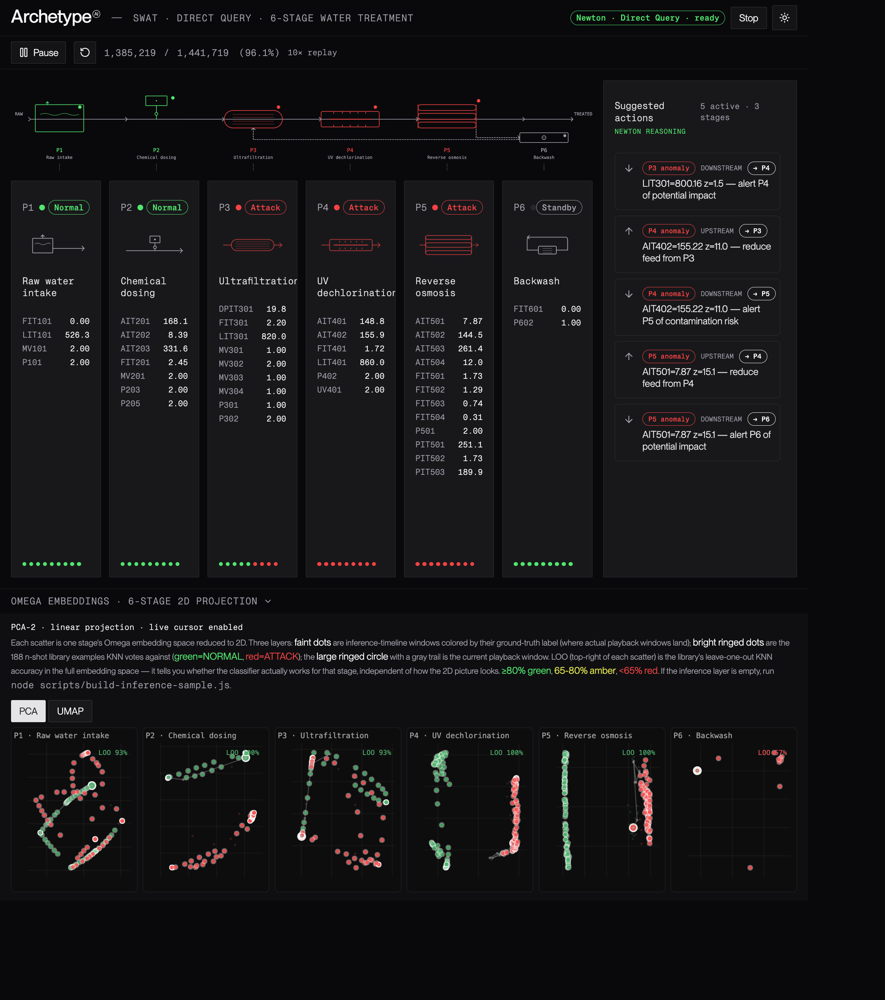
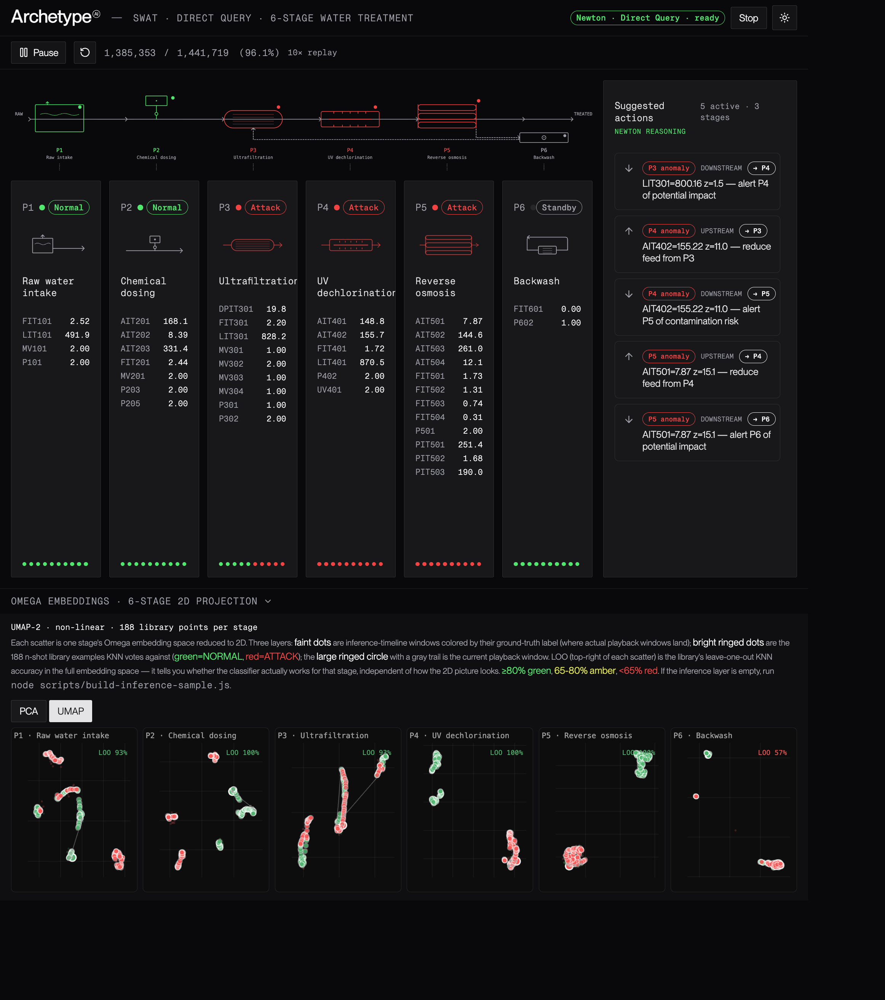

# archetypeai-swat-demo-model-serving



A water treatment plant paved with sensors: **Newton Omega 1.5** embeds each stage's sensor window and a local KNN detects per-stage anomalies in real time, and **Newton C 2.6** suggests upstream and downstream actions to an operator. Both models are called through the Archetype AI **Inference API**.

Moved from the [Direct Query version](https://github.com/archetypeai/archetypeai-swat-demo-direct-query) (Omega 1.4 and Newton C 2.6 on `/api/lens/query`). See [MIGRATION.md](MIGRATION.md) for what changed and how the two compare.

- **Classification**: Omega 1.5 embeddings from one Inference API session, then K-nearest-neighbours against a precomputed n-shot embedding library.
- **Operator suggestions**: Newton C 2.6 on the Inference API, called from the server.
- **Embedding visualization panel**: collapsed by default, shows the Omega 2D layout per stage (PCA-2 + UMAP-2) with a live cursor that follows the playback window.

## Concept

Same six-stage water treatment plant:

1. **P1** — Raw water intake and storage
2. **P2** — Chemical dosing (pre-treatment)
3. **P3** — Ultrafiltration (UF)
4. **P4** — UV dechlorination
5. **P5** — Reverse osmosis (RO)
6. **P6** — Backwash / cleaning

Six per-stage classifiers, each trained on its own sensor subset (n-shot normal vs attack). When a stage flags anomalous, the UI surfaces suggested actions on adjacent stages — framed as suggestions for a human operator.

## Stack

Svelte 5 + SvelteKit · Tailwind v4 · `@archetypeai/ds-lib-tokens` · bits-ui · layerchart · `umap-js` (server-side projection fit) · `plotly.js-dist-min` (client-side scatters).

## Setup

Requires Node 20+, Python 3 (standard library only, for the data prep), an Archetype AI API key, and the SWaT dataset.

```bash
git clone https://github.com/archetypeai/archetypeai-swat-demo-model-serving.git
cd archetypeai-swat-demo-model-serving

cp .env.example .env
# edit .env: ATAI_API_KEY, and ATAI_API_ENDPOINT if not production

npm install
```

The project's `.env` takes precedence over `ATAI_*` variables exported in your shell (see `vite.config.js`), so a shell profile pointing at another deployment can't redirect the app.

### Data

The SWaT dataset isn't included: it's distributed by iTrust, and this repo doesn't redistribute it. See [Data](#data) for where to get it. Put the two raw CSVs in `data/`, then:

```bash
python3 scripts/convert_swat_data.py   # → data/swat_raw_labeled.csv (the full labeled timeline)
python3 scripts/generate_labels.py     # → data/swat_normal.csv, swat_attack.csv, swat_playback.csv
```

`data/scaler.json` (per-channel mean and standard deviation of the n-shot pool) is committed. To recompute it: `node scripts/build-scaler.js`.

### Build the library, then run

```bash
# One-time: embed the n-shot library the KNN votes against.
node scripts/build-knn-library.js --step=20
# 1,128 Omega queries (188 windows × 6 stages), about 5 minutes.
# Output: data/knn-library.json (~110 MB, gitignored).

# Optional: background dots of held-out playback windows for the embedding panel.
node scripts/build-inference-sample.js --offset=1384098 --rows=6000
# 276 queries, under 2 minutes. Writes data/inference-sample.json (gitignored).
# Offset 1384098 = row 0 of the held-out playback window, so the dots line up with what you replay.

npm run dev
```

Open the dev URL, press **Start analysis**, then **Play** to replay the SWaT timeline at 10× real time and watch classifications stream in. The first classification opens the Omega session and takes a few seconds; after that each window takes about 2 s for all six stages.

To score the classifier on the held-out playback stream: `node scripts/eval-playback.js` (see [What the held-out numbers show](#what-the-held-out-numbers-show)).

## How the demo uses the Inference API

Three flows: **build** (offline, one-time), **classify** (per playback window), **reason** (when anomalies change). All API calls go through `src/lib/inference-client.js`, which the server and the build scripts share.

**Scaler (offline, `node scripts/build-scaler.js`):** per-channel mean and standard deviation over `swat_normal.csv` + `swat_attack.csv`, saved to `data/scaler.json`. Every window is scaled with it before embedding, so the library and live windows share one reference frame.

**Library (offline, `node scripts/build-knn-library.js --step=20`):**

1. Read `swat_normal.csv` and `swat_attack.csv` (2,000 rows each).
2. Slide 128-row windows across each file with `step=20` (94 windows per class per stage, 188 per stage).
3. For each window: scale it, then embed **all of the stage's channels in one query** to an Omega session whose `window_size` is 128. The answer is one row of `channels × 768` values, the per-channel vectors in channel order. Tag it `NORMAL` or `ATTACK` by the file it came from.
4. Save to `data/knn-library.json`.

**Classify (per playback window, `/api/classify`):**

1. Take the 128 rows under the playhead.
2. For each stage, scale the stage's channels and embed them in one query to the server's Omega session (six queries per window, in parallel).
3. Euclidean distance to every library embedding of that stage; majority vote of the 3 nearest → `NORMAL` or `ATTACK`.
4. Project the embedding with the library's PCA-2 and UMAP-2 for the embedding panel.

KNN doesn't "train" in the way a neural net does — the library _is_ the model. The build phase embeds the n-shot examples once and stores them with their labels; every runtime prediction is a distance lookup against that stored set.

**Reason (`/api/suggestions`):** whenever the set of anomalous stages changes, the browser posts the plant state to `/api/suggestions`. The server builds the prompt (with per-sensor baselines from `swat_normal.csv`), asks Newton C 2.6, validates the JSON cards against the plant topology, and caches the answer by the set of anomalous stages. The prompt and parser live in `src/lib/server/suggestions.js`. The API key stays on the server.

### The Omega session

The server opens one session on `omega-embedding` the first time it classifies a window, and reuses it for every stage:

```json
POST /api/inference/sessions
{ "model": "omega-embedding", "values": { "window_size": 128, "step_size": 128 } }
```

Each query carries one stage's window, channel first:

```json
POST /api/inference/sessions/{id}/query
{
  "model": "omega-embedding",
  "query": "",
  "events": [
    { "type": "data.numeric_array", "event_data": { "contents": [[/* channel 1: 128 values */], [/* channel 2 */], "..."] } }
  ]
}
```

and the answer is one row per window:

```json
{
	"response": {
		"success": true,
		"response": [
			[
				/* channels × 768 values */
			]
		]
	}
}
```

Things the client handles (`OmegaSession` in `src/lib/inference-client.js`):

- **Exactly one window per query.** Input shorter than `window_size` comes back as `success: false` with no message, so the client checks each channel's length before sending.
- **Sessions end.** A session ends when it expires or the model is redeployed, and then answers `409 session_not_running`; the client opens a new one and resends.
- **Session limit.** An organization can hold 16 open sessions on the model. The server cancels its session when it stops (`npm run dev` and Ctrl-C included), and the build scripts cancel theirs when they finish or fail.
- **Normalization.** Omega 1.5 standardizes each window itself and passes the window's original scale to the encoder; the shared scaler above still puts the library and live windows in one reference frame.

Newton C 2.6 is a plain query, no session:

```json
POST /api/inference/query
{ "model": "newton-c-2.6", "query": "...", "instruction_prompt": "...", "max_new_tokens": 1500 }
```

## Embedding panel

Collapsed by default — click "Omega embeddings · 6-stage 2D projection" at the bottom to expand. Six small scatters, one per stage. Mode toggle: **PCA** vs **UMAP**.



Three layers per scatter:

- **Faint dots** — inference-timeline windows (build with `node scripts/build-inference-sample.js`), coloured by their ground-truth `normal`/`attack` label from `swat_raw_labeled.csv`. Optional: it needs `swat_raw_labeled.csv`, which the data prep writes. Shows where actual playback windows land in the embedding space, independent of what the library thinks.
- **Bright ringed dots** — the n-shot library examples KNN votes against (green = NORMAL, red = ATTACK).
- **Large ringed circle with a gray trail** — the current playback window, projected through the same PCA / UMAP that was fit on the library.

Each scatter also shows a **LOO** badge: leave-one-out KNN accuracy in the full (not 2D) embedding space, per stage. Green ≥80%, amber 65–80%, red <65%. This is the diagnostic for whether the classifier actually works for that stage — the 2D picture is a lossy summary, but LOO is computed on the real embeddings.

- **PCA-2** is computed by power iteration over the centered covariance of the library embeddings (linear, ~ms in JS, accurate transform on any new point).
- **UMAP-2** is fit with `umap-js` on the library embeddings. `umap.transform(new_embedding)` projects live windows into the same 2D space.
- Both projections are fit once at server boot and cached in memory; no offline script needed.

Why not t-SNE: t-SNE has no `transform()` for new points by construction — adding the live cursor would force a refit on every tick, producing a totally different layout each time.

## Data

### Attribution

The SWaT (Secure Water Treatment) dataset was created by [iTrust, Centre for Research in Cyber Security](https://itrust.sutd.edu.sg/) at the Singapore University of Technology and Design (SUTD). It's distributed on request through [iTrust's official channels](https://itrust.sutd.edu.sg/itrust-labs_datasets/); request it there for published work.

11 consecutive days of 1-second readings from a scaled-down but fully operational six-stage water treatment plant — 7 days of normal operation followed by 4 days with 36 cyber-physical attack scenarios.

### Download

Request the dataset from iTrust, or download the normal and attack CSVs from the [Kaggle mirror](https://www.kaggle.com/datasets/vishala28/swat-dataset-secure-water-treatment-system), and put them in `data/`. `scripts/convert_swat_data.py` accepts the usual file names (`SWaT_Dataset_Normal_v1.csv`, `SWaT_Dataset_Attack_v0.csv`, and a few variants). The Kaggle mirror is an individual's upload and states no licence of its own; iTrust's terms still apply.

### Prep

`scripts/convert_swat_data.py` merges the normal and attack CSVs, forward-fills missing SCADA values and drops 11 constant-value actuators, writing `data/swat_raw_labeled.csv`. `scripts/generate_labels.py` then writes:

- `swat_normal.csv` / `swat_attack.csv` — n-shot **training** examples (the KNN library), 2,000 rows each
- `swat_playback.csv` — the **held-out** stream the demo replays (see below)

`swat_raw_labeled.csv` is only read again by `build-inference-sample.js`. Generated files (`knn-library.json`, `inference-sample.json`) and every CSV in `data/` are gitignored.

### Data split — leakage-free by construction

Training (the n-shot KNN library) and playback (what the demo streams) come from **disjoint, contiguous time ranges**, so no played window is ever embedded into the library:

- The timeline is one long **normal** block followed by one **attack** block.
- **Training:** n-shot normal is drawn from the middle of the normal block; n-shot attack is drawn from a _later_ slice of the attack block.
- **Playback (`swat_playback.csv`):** a separate contiguous slice — a normal lead-in → the normal→attack transition → early attack — that ends _before_ the attack n-shot slice (with a gap between).

`scripts/generate_labels.py` carves these ranges (constants `PLAYBACK_NORMAL_LEAD`, `PLAYBACK_ATTACK_ROWS`, `NSHOT_ATTACK_GAP`) and **asserts** `playback ∩ n-shot = 0 rows` before writing — so the split can't silently regress. This is why playback reads its own file rather than seeking into the full timeline.

### What the held-out numbers show

Once train and playback are genuinely disjoint, the demo's behaviour is more honest — and more modest — than it first appears. `node scripts/eval-playback.js` scores every non-overlapping 128-row window of the held-out playback stream the same way `/api/classify` does; a window counts as flagged when any stage says ATTACK. On production (Omega 1.5, 2026-11-13):

|                                               | Result                                                  |
| --------------------------------------------- | ------------------------------------------------------- |
| Normal windows flagged (false alarms)         | **0 of 23**                                             |
| Attack windows flagged                        | **149 of 234** (64%)                                    |
| First flag after the normal→attack transition | **1,480 rows** (about 25 minutes of plant time at 1 Hz) |
| Attack windows flagged per stage              | P1 126 · P2 145 · P3 123 · P4 115 · P5 111 · P6 0       |

- **No false alarms on normal windows.**
- **Attacks are detected once they manifest, not the instant the label flips.** The first windows after the transition classify NORMAL; detection lights up further into the attack period, on windows that resemble the disjoint attack examples in the library. The attack label covers the whole attack period, including stretches where no attack is active, so 64% is a floor on per-window recall rather than a miss rate.
- **P6 never flags.** It has two sensors and is mostly idle; its library separates NORMAL from ATTACK no better than chance (LOO 50%).

**Why:** n-shot KNN can only recognize attacks that resemble something in its library, and SWaT's attack period is heterogeneous — the early attacks we play are a different signature than the (disjoint) attacks the library was built from. You can't add the early attacks to the library without re-introducing leakage, because they only occur in the region we play.

**The lesson this demo is meant to teach:** an earlier version drew its attack n-shot examples from the _same_ rows it later replayed, so KNN was scoring played windows against near-copies of themselves — leakage that made detection look near-perfect. Removing it (the split above) reveals the true n-shot behaviour. Treat the demo as _"detection fires as an attack grows into something the model has seen before,"_ not as a perfect per-window detector. The **LOO badges** in the embedding panel measure separability _within the library_ (a sanity check on the examples), which is a different and easier question than detecting genuinely unseen attacks.

## Scope caveats

- Anomaly labels in SWaT are plant-wide, not per-stage. Each per-stage classifier is a best-effort inference based on _that stage's own sensors_ — we're explicitly _not_ looking at labels to decide which stage saw the attack.
- The Suggested Actions panel is strictly Reason-layer: it surfaces operator guidance, never takes control actions. For any real deployment, actuation would require a separate safety-reviewed control path.
- UMAP fitted on 188 library points per stage is a low-data regime; the layout is suggestive of structure but not precise. If you want sharper UMAP, increase the library by pre-embedding a chunk of inference data and including it in the fit set.

## Licence

The code is under the [Apache License 2.0](LICENSE). The SWaT dataset isn't included and isn't covered by it: it belongs to iTrust, SUTD, and is used under iTrust's terms (see [Data](#data)). `data/scaler.json` holds only per-channel summary statistics computed from it.
